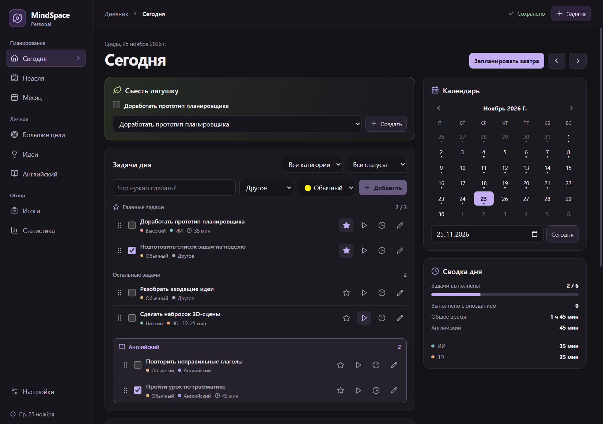
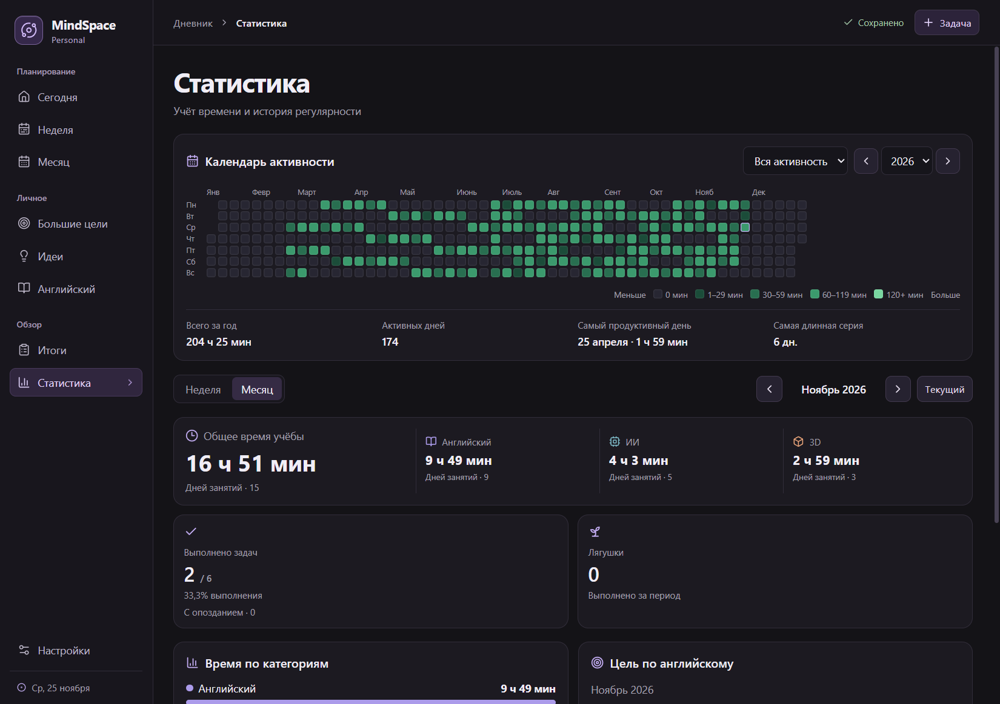
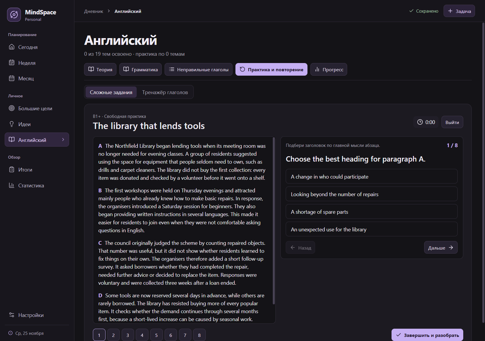

# MindSpace Personal

MindSpace Personal is a local-first Windows desktop planner that combines daily tasks, long-term goals, a journal, and English practice. It was built to turn a personal planning and study routine into a single application that works offline with no account.

**Release:** [MindSpace Personal 1.6.1 for Windows x64](https://github.com/weber2kl/MindSpace-Personal/releases/tag/v1.6.1)

## Screenshots

Screenshots are from the Windows application running with a synthetic demo profile. The interface is in Russian.

| Daily planner | Activity calendar |
| --- | --- |
|  |  |



## What it does

- Organize tasks by date and category, select up to three top priorities, and set one “eat the frog” task. Reorder tasks within their groups and reschedule unfinished work while keeping its original date.
- Connect weekly and monthly plans to long-term goals. Set monthly targets for completed tasks or study time.
- Track time manually or with a pauseable task timer. Review work by category, daily study streaks, and activity across the year.
- Study English grammar, practise irregular verbs, and complete reading, grammar, and writing exercises. Writing uses model answers and a self-review checklist.
- Store the journal locally, export or import JSON, and make verified SQLite backups. Seven recent automatic backups are retained when the app has saved data and is opened regularly.

## Architecture and data

The interface uses **React, TypeScript, and Vite**. An **Electron** main process handles file dialogs, backup operations, and storage. A narrow preload bridge exposes those operations to the sandboxed renderer with Node integration disabled. Production assets are served from a local application protocol. **electron-builder and NSIS** package the Windows installer.

The storage layer uses **Node.js SQLite** with write-ahead logging. It stores a validated planner snapshot with a revision counter. Revision checks protect against stale writes. Backup creation uses the SQLite backup API and checks the copied database before saving it. Restoration validates the incoming file and saves a separate copy of the current data before replacement.

On Windows, the live database is at `%APPDATA%\MindSpace Personal\personal.sqlite3`. Backups created in the app live in the `backups` directory beside it. The development build and automated checks use separate profiles. Keep a copy on another drive if you need to recover from disk failure.

## Install or run locally

1. Download `MindSpace-Personal-Setup-1.6.1-x64.exe` from the [Windows release](https://github.com/weber2kl/MindSpace-Personal/releases/tag/v1.6.1).
2. Run the installer, then open **MindSpace Personal** from the Start menu.
3. Before updating an existing installation, make a backup in **Settings → Data and backups** and close the app. Select the existing installation directory in the new installer.

For development and packaging, use Windows x64 and Node.js **26.13.0** (the version used for this release) with npm:

```powershell
npm ci
npm run dev
```

```powershell
npm run check
npm test
npm run build:windows
npm run test:desktop
node desktop/features-qa.mjs
```

The build writes the installer and an unpacked application to `release/1.6.1/`. To run the unpacked application, keep the whole `win-unpacked` directory together and launch `MindSpace Personal.exe` in that folder.

For 1.6.1, 48 automated tests passed. The packaged application also passed Windows launch, offline loading, task reordering, practice, backup, restore, and restart checks with isolated profiles.

## Known limitations

- This build targets Windows x64. The installer is unsigned, so Windows may show a publisher or SmartScreen warning. Updates are installed manually.
- Data, backups, and progress are local to the Windows profile. There is no cloud sync.
- Essay answers are for self-review. Practice answers are written to the database after submitting the exercise.
- The installer archive was checked separately from the application. The installer wizard was not run on the development machine over an existing installation.

## AI-assisted development

The project was developed iteratively with **Codex**. I shaped the product around my own planning workflow and used Codex to help implement features, debug edge cases, and write and run tests. The technically hardest work was keeping offline data dependable across interruptions, backups, restores, and upgrades.

The source is publicly viewable. This repository does not grant an open-source license.
